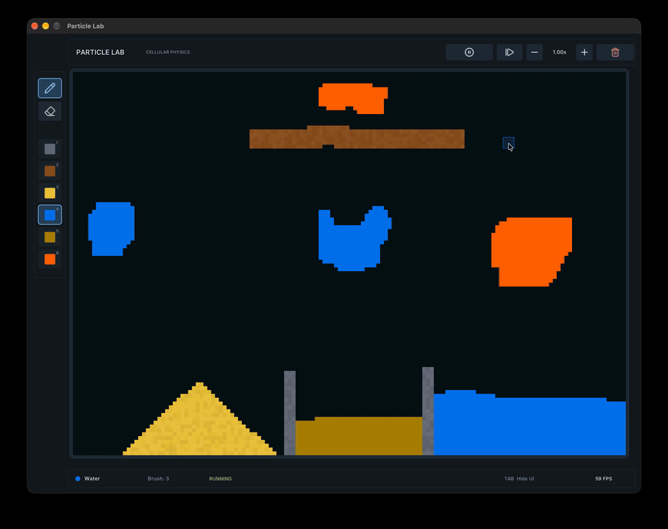
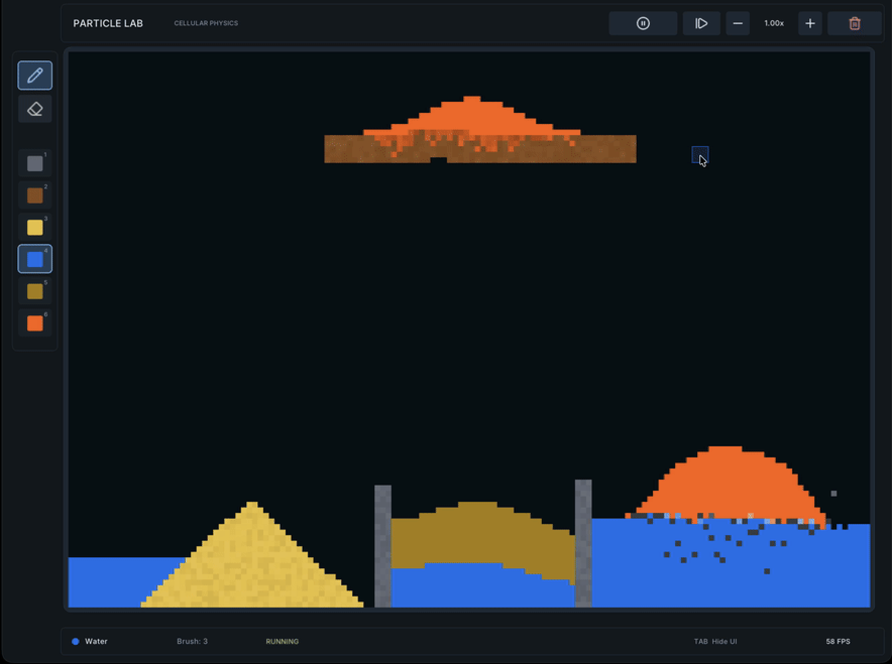

# Particle Lab

An experimental 2D cellular physics sandbox built with **C++17 and raylib**. Paint materials, shape a scene, and watch falling sand, flowing liquids, and reactive elements interact.



## Inside the sandbox

- **Powders in motion** — gravity-driven sand that piles up and displaces less-dense liquids.
- **Distinct liquid behavior** — water, oil, and lava use different flow rates and falling speeds, with density-based displacement and sideways spreading on impact.
- **Reactive materials** — lava ignites wood, consumes nearby oil, and breaks down sand. Contact with water produces steam and cooling rock, which settles into stone.
- **Rising gases** — smoke and steam move through the scene and dissipate over time.
- **Hands-on experimentation** — adjustable square brush, continuous paint strokes, eraser, pause, single-step updates, and simulation speeds from 0.25× to 4×.

These are custom, grid-based rules for exploring material interactions, rather than a physically accurate fluid solver.

## Materials

| Key | Material | Behavior |
| --- | --- | --- |
| `1` | Stone | Static barriers and containers |
| `2` | Wood | Static, combustible structures |
| `3` | Sand | Falling powder that forms piles |
| `4` | Water | Fast-flowing liquid that cools lava |
| `5` | Oil | Lighter than water, with slower lateral flow |
| `6` | Lava | Dense, slow-flowing liquid that triggers reactions |

Smoke, steam, and cooling rock are generated by reactions; they are not brush selections.

## Interface



A compact material palette and simulation toolbar frame the canvas. The status bar shows the selected material, brush size, simulation state, and FPS. Hide the interface with `Tab` for an unobstructed view.

## Controls

| Input | Action |
| --- | --- |
| Left mouse drag | Paint with the selected material, or erase when the eraser tool is selected |
| Right mouse drag | Erase |
| `1`–`6` | Select a material and return to the drawing tool |
| Mouse wheel / `=` / `-` | Increase or decrease brush size |
| `Space` | Pause / resume |
| `N` | Advance one simulation update while paused |
| `↑` / `↓` | Double / halve simulation speed, within 0.25×–4× |
| `Tab` | Show / hide the interface |

The toolbar also provides pause, step, speed, and clear-canvas buttons. Use the pencil and eraser buttons to switch tools.

## Build and run on macOS

Requires the Xcode Command Line Tools (`clang++` and `make`), Homebrew, raylib, and `pkg-config` (provided by `pkgconf`). The Makefile uses C++17 and discovers raylib through `pkg-config`.

Install the command-line tools if needed, then complete the installer before continuing:

```sh
xcode-select --install
```

Install dependencies:

```sh
brew install raylib pkgconf
```

From the repository root:

```sh
make
./particle_lab
```

Run from the repository root so the font and toolbar icons in `assets/` can be loaded. The default build produces `particle_lab`; `make clean` removes it.

## Project layout

```text
src/
├── physics/       Material physics and reactions
├── Application.cpp
├── Simulation.cpp
├── Grid.cpp
├── Renderer.cpp
└── UIRenderer.cpp

include/sandbox_lab/   Headers and material definitions
assets/                Fonts and UI icons
docs/                  Demo and screenshots
Makefile
```

## Why Particle Lab?

A small space to explore how local rules create larger patterns: a pile of sand, a spreading pool, or a reaction that changes the scene. The focus is on interactive experiments with cellular simulation and rendering in C++.

## License

Licensed under the [MIT License](LICENSE). Copyright (c) 2026 ygokdogan.

Third-party libraries and assets retain their own licenses; see [Third-party notices](THIRD_PARTY_NOTICES.md).
