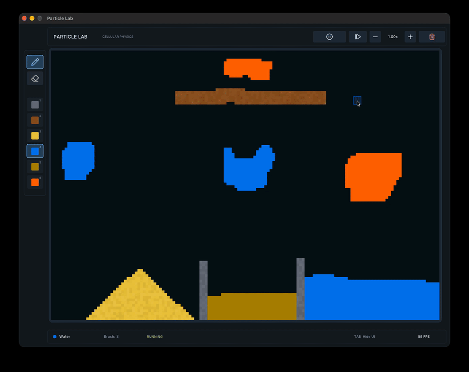
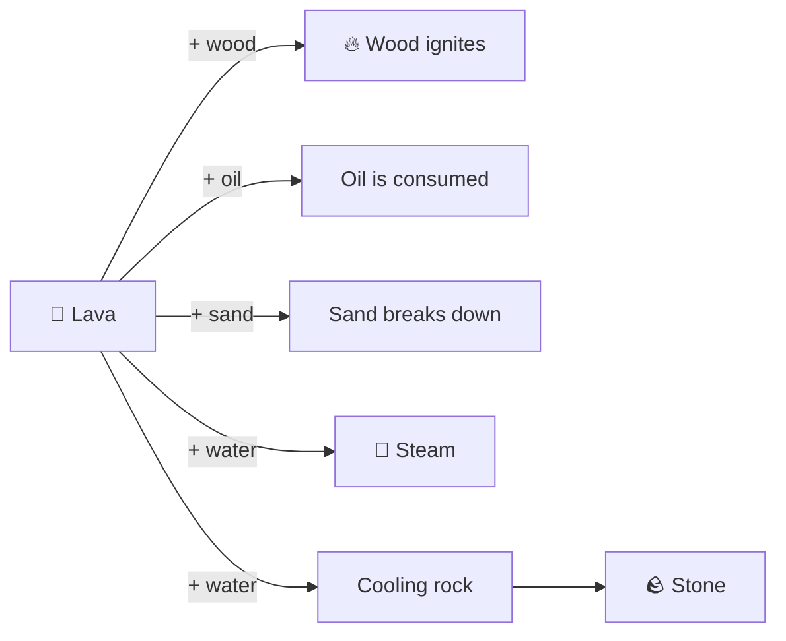
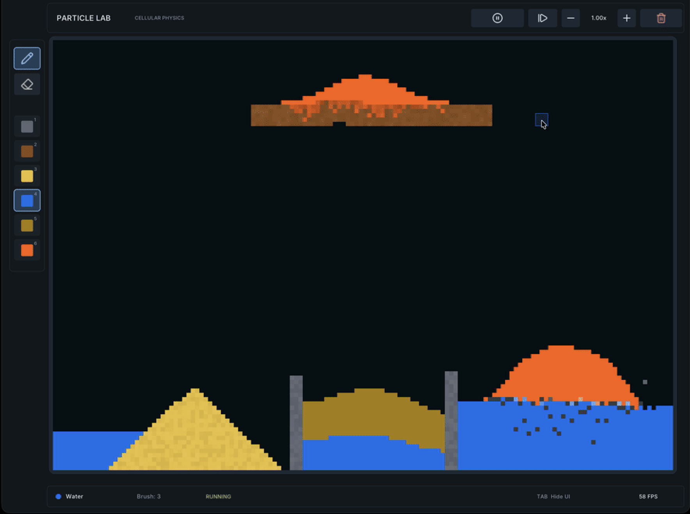

<div align="center">

# 🏖️ Particle Lab

**Paint materials, shape a scene, and watch falling sand, flowing liquids and reactive elements interact.**

[](https://en.cppreference.com/w/cpp/17)
[](https://www.raylib.com/)
[](#-build-and-run-on-macos)
[](LICENSE)



[**🧪 Materials**](#-materials) · [**🎮 Controls**](#-controls) · [**🛠️ Build**](#-build-and-run-on-macos) · [**📁 Layout**](#-project-layout)

</div>

---

An experimental 2D cellular physics sandbox built with **C++17** and **raylib**.

## ✨ Inside the sandbox

- 🏜️ **Powders in motion** — gravity-driven sand that piles up and displaces less-dense liquids.
- 🌊 **Distinct liquid behavior** — water, oil and lava use different flow rates and falling speeds, with density-based displacement and sideways spreading on impact.
- 🔥 **Reactive materials** — lava ignites wood, consumes nearby oil and breaks down sand. Contact with water produces steam and cooling rock, which settles into stone.
- 💨 **Rising gases** — smoke and steam move through the scene and dissipate over time.
- 🖌️ **Hands-on experimentation** — adjustable square brush, continuous paint strokes, eraser, pause, single-step updates and simulation speeds from 0.25× to 4×.

> [!NOTE]
> These are custom, grid-based rules for exploring material interactions — not a physically accurate fluid solver.

## 🧪 Materials

| Key | Material | Behavior |
| :---: | --- | --- |
| <kbd>1</kbd> | 🪨 Stone | Static barriers and containers |
| <kbd>2</kbd> | 🪵 Wood | Static, combustible structures |
| <kbd>3</kbd> | 🏜️ Sand | Falling powder that forms piles |
| <kbd>4</kbd> | 💧 Water | Fast-flowing liquid that cools lava |
| <kbd>5</kbd> | 🛢️ Oil | Lighter than water, with slower lateral flow |
| <kbd>6</kbd> | 🌋 Lava | Dense, slow-flowing liquid that triggers reactions |

Smoke, steam and cooling rock are generated by reactions; they are not brush selections.



## 🖥️ Interface



A compact material palette and simulation toolbar frame the canvas. The status bar shows the selected material, brush size, simulation state and FPS. Press <kbd>Tab</kbd> to hide the interface for an unobstructed view.

## 🎮 Controls

| Input | Action |
| --- | --- |
| Left mouse drag | Paint with the selected material, or erase when the eraser tool is selected |
| Right mouse drag | Erase |
| <kbd>1</kbd>–<kbd>6</kbd> | Select a material and return to the drawing tool |
| Mouse wheel / <kbd>=</kbd> / <kbd>-</kbd> | Increase or decrease brush size |
| <kbd>Space</kbd> | Pause / resume |
| <kbd>N</kbd> | Advance one simulation update while paused |
| <kbd>↑</kbd> / <kbd>↓</kbd> | Double / halve simulation speed (0.25×–4×) |
| <kbd>Tab</kbd> | Show / hide the interface |

The toolbar also provides pause, step, speed and clear-canvas buttons. Use the pencil and eraser buttons to switch tools.

## 🛠️ Build and run on macOS

**Requirements:** Xcode Command Line Tools (`clang++`, `make`), Homebrew, raylib and `pkg-config` (provided by `pkgconf`). The Makefile uses C++17 and discovers raylib through `pkg-config`.

**1.** Install the command-line tools if needed, and finish the installer before continuing:

```sh
xcode-select --install
```

**2.** Install dependencies:

```sh
brew install raylib pkgconf
```

**3.** Build and run from the repository root:

```sh
make
./particle_lab
```

> [!TIP]
> Run from the repository root so the font and toolbar icons in `assets/` can be loaded. The default build produces `particle_lab`; `make clean` removes it.

## 📁 Project layout

```text
src/
├── physics/       Material physics and reactions
├── Application.cpp
├── Simulation.cpp
├── Grid.cpp
├── Renderer.cpp
└── UIRenderer.cpp

include/sandbox_lab/   Headers and material definitions
assets/                Fonts and UI icons
docs/                  Demo and screenshots
Makefile
```

## 💭 Why Particle Lab?

A small space to explore how local rules create larger patterns: a pile of sand, a spreading pool, or a reaction that changes the scene. The focus is on interactive experiments with cellular simulation and rendering in C++.

## 📄 License

Licensed under the [MIT License](LICENSE). Copyright (c) 2026 ygokdogan.

Third-party libraries and assets keep their own licenses; see [Third-party notices](THIRD_PARTY_NOTICES.md).

---

<div align="center">

Made by [**Yusuf Emir Gökdoğan**](https://github.com/ygokdogan) · ⭐ Star the repo if you had fun!

</div>
